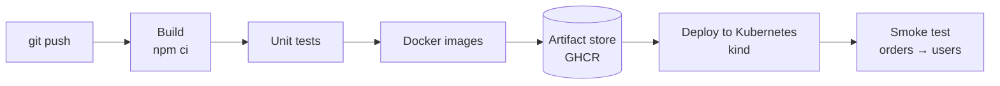

# CI/CD for containerised microservices

Two small Node.js microservices go from `git push` to a running Kubernetes cluster with no manual steps:
build, test, package as Docker images, store in a registry, deploy, and check that the services can talk to each other.

[Live pipeline →](https://danielkojomegbenu.com/projects/microservices-cicd)

## The services

| Service | What it does |
|---|---|
| `users` | Owns the list of users: `GET /users`, `GET /users/:id` |
| `orders` | Owns orders, and calls `users` to add each customer's name: `GET /orders`, `GET /orders/:id` |

In Kubernetes, `orders` reaches `users` at `http://users:8080`, the users Service's DNS name.

## The pipeline



| Step | What happens |
|---|---|
| 1. Build | `npm ci` installs each service's exact locked dependencies |
| 2. Unit tests | `node --test` for each service (9 tests, no extra test libraries) |
| 3. Docker images | One image per service, on `node:24-alpine`, running as a non-root user |
| 4. Artifact store | Both images are pushed to GitHub Container Registry, tagged with the commit SHA and `latest` |
| 5. Deploy | A real Kubernetes cluster ([kind](https://kind.sigs.k8s.io/)) is created in the pipeline. The cluster **pulls the images from GHCR**, so it runs exactly what was stored, and the pipeline waits until every pod is ready |
| 6. Smoke test | Calls `orders` in the cluster and checks every order has a customer name. Names live only in `users`, so a pass proves the two services talk over Kubernetes DNS |

Pull requests run steps 1 to 3. A failing test stops the run before any image is built or stored. Only `main` pushes and deploys.

The kind cluster is thrown away when the run ends, so nothing is left running and nothing costs money.

## Two ways to run it

**GitHub Actions** runs it on every push: [`.github/workflows/ci-cd.yml`](.github/workflows/ci-cd.yml). This drives the live diagram on the case study page.

**Jenkins** runs the same stages from the [`Jenkinsfile`](Jenkinsfile). To try it on your machine with Docker Desktop running:

```bash
docker compose -f jenkins/docker-compose.yml up -d --build
```

Open http://localhost:8090, sign in as `admin` / `admin`, and run the **microservices-cicd** job. Jenkins starts with the job already configured (Configuration as Code). Build, test and the Docker images run as they are. To also push and deploy, add two credentials (`ghcr`: username and a token with `write:packages`; `kubeconfig`: a secret file) and tick **PUSH_AND_DEPLOY**.

## What's in the repo

| Path | What it is |
|---|---|
| `services/users/`, `services/orders/` | The two services, their tests and Dockerfiles |
| `k8s/` | A Deployment and a Service for each, with health probes, resource limits and a locked-down security context |
| `scripts/deploy.sh` | Applies the manifests with the image tag and waits for the rollout |
| `scripts/smoke-test.sh` | The end-to-end check through both services |
| `.github/workflows/ci-cd.yml` | The pipeline on GitHub Actions |
| `Jenkinsfile`, `jenkins/` | The same pipeline on Jenkins, and a local Jenkins to run it |

## Run the services locally

```bash
cd services/users && npm ci && PORT=8081 npm start
cd services/orders && npm ci && USERS_URL=http://localhost:8081 PORT=8082 npm start
curl localhost:8082/orders
```

## See a failing test stop the pipeline

Change what `users` returns, for example rename `name` to `fullName` in `services/users/app.js`, and open a pull request. The users tests fail, the run stops at **Unit tests**, and no image is built or pushed.

## Cost

Free. GitHub Actions minutes are free for public repos, GHCR is free for public images, and the kind cluster only exists while the pipeline runs.
